1. bitcoin-core 릴리즈 tarball 다운로드 및 해제
```
curl -O https://bitcoin.org/bin/bitcoin-core-31.0/bitcoin-31.0-x86_64-linux-gnu.tar.gz
tar -xf bitcoin-31.0-x86_64-linux-gnu.tar.gz -C /opt
```

2. 심링크
```
ln -sfn /opt/bitcoin-31.0 /opt/bitcoin
ln -s /opt/bitcoin/bin/* /usr/local/bin
```

3. [bitcoin-core 소스트리](https://github.com/bitcoin/bitcoin)의
   [contrib/init/bitcoind.service](https://github.com/bitcoin/bitcoin/blob/master/contrib/init/bitcoind.service)
   파일 받아오기 및 패치
```
curl -LO https://github.com/bitcoin/bitcoin/raw/refs/tags/v31.0/contrib/init/bitcoind.service \
     --output-dir /etc/systemd/system/

systemctl daemon-reload
systemctl edit --stdin bitcoind <<'EOF'
[Service]
ProtectHome=tmpfs
BindPaths=/home/bitcoin
ExecStart=
ExecStart=/usr/local/bin/bitcoind -pid=/run/bitcoind/bitcoind.pid \
                                  -conf=/etc/bitcoin/bitcoin.conf \
                                  -datadir=/home/bitcoin \
                                  -startupnotify='systemd-notify --ready' \
                                  -shutdownnotify='systemd-notify --stopping'
EOF
```

4. Service용 유저 생성
```
useradd --system -m --user-group --home-dir /home/bitcoin --shell /usr/sbin/nologin bitcoin
```

5. 기본 설정 파일 복사
```
mkdir -p /etc/bitcoin/
chown root:bitcoin /etc/bitcoin && chmod 0710 /etc/bitcoin
cp /opt/bitcoin/bitcoin.conf /etc/bitcoin/
```

6. 설정 조금 추가
```
server=1
listen=1
dbcache=4096         # 처음 동기화(IBD)할때만 크게. 끝나면 그냥 기본값으로 낮추기
rpccookieperms=group # 쿠키 파일 bitcoin 그룹에서 읽기
txindex=1            # 임의 txid 조회
#prune=550           # 디스크 모자랄때 (txindex랑 같이못씀)
```

7. 띄워잇
```
systemctl enable --now bitcoind
```

8. 로그 보기
```
journalctl -u bitcoind -f
```

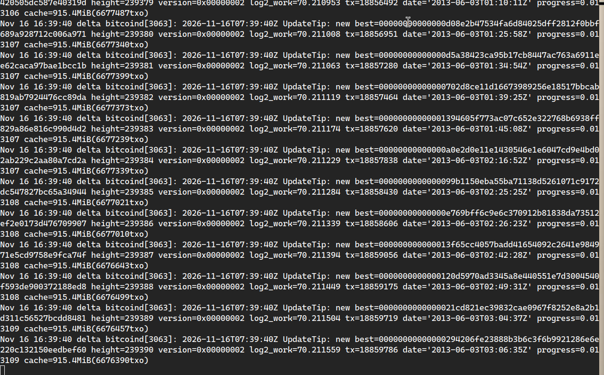

## 실제 비트코인 보내보기

사용 키:
| 항목 | 값 |
|---|---|
| 공개키 (compressed) | `03cfe157d8643d83d91e8506ecc182de4e49632dab108b6f116725105a377a5df7` |
| HASH160 | `ccea80d10a571e036bcb096322b95ea0e648b7ef` |
| BTC P2PKH | [`1KgVmhe4STpQimwzWNtCPNEMQhKTH2Qeqp`](https://mempool.space/address/1KgVmhe4STpQimwzWNtCPNEMQhKTH2Qeqp) |
| DOGE P2PKH | [`DPpbJxahjsihFn8bExskw8PxHq3khkCNXE`](https://dogechain.com/address/DPpbJxahjsihFn8bExskw8PxHq3khkCNXE) |

보낸 방식:
```
 [Upbit]
    |  DOGE withdraw
    v
 [Binance]  DTGEgw1ZoQidVLb7CNMCQ8kypUwvtTGUHy
    |  DOGE withdraw (after 36 confirmations)
    |  tx 6a4346f3...0fe245 : vout 0 = 100 DOGE
    v
 [my key / DOGE]  DPpbJxahjsihFn8bExskw8PxHq3khkCNXE
    |                ^
    |                `-- pubkey 03cfe157...7a5df7  (bic genkey / pkey)
    |
    |  signed with doge-tx.py (libsecp256k1, legacy sighash)
    |  broadcast via blockchair push API
    |  tx d730db3d...b98138 : 99.8 DOGE (fee 0.2)
    v
 [ChangeNOW]  DSnFnqrc2i9Y2WfvdrYE5syx3d5oGTrot7
    |  DOGE -> BTC swap
    |  tx 666826ef...b147ef : vout 0 = 8,331 sat
    v
 [my key / BTC]  1KgVmhe4STpQimwzWNtCPNEMQhKTH2Qeqp
    |                ^
    |                `-- same pubkey, same HASH160 ccea80d1...48b7ef
    v
 [bitcoind]  watch-only  pkh(03cfe157...7a5df7)
             mempool (0 conf) -> P2P relay -> in block (1 conf)
```

1. 내 계정에서 bitcoin-cli 쓰기 (쿠키 그룹 읽기)
```
usermod -aG bitcoin hskim   # 재로그인 or newgrp bitcoin
echo 'rpccookiefile=/home/bitcoin/.cookie' >> ~/.bitcoin/bitcoin.conf
```

2. 키 생성 ([bic](https://github.com/dilluti0n/bic))
```
bic genkey > key
bic pkey < key > pkey
```
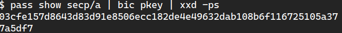

3. 주소 만들기
```
# BTC (P2PKH)
bitcoin-cli getdescriptorinfo "pkh($(od -An -tx1 -v pkey | tr -d ' \n'))"
bitcoin-cli deriveaddresses 'pkh(03cfe1...5df7)#rqldzk0q'   # 1KgVmhe4STpQimwzWNtCPNEMQhKTH2Qeqp

# DOGE (P2PKH, version byte 0x1e)
./doge-addr.py pkey                                         # DPpbJxahjsihFn8bExskw8PxHq3khkCNXE
```
같은 HASH160, 버전 바이트만 다름 (BTC `0x00`, DOGE `0x1e`)

4. bitcoind에 watch-only로 등록
```
bitcoin-cli -named createwallet wallet_name=eps disable_private_keys=true blank=true
bitcoin-cli -rpcwallet=eps importdescriptors \
  '[{"desc":"pkh(03cfe1...5df7)#rqldzk0q","timestamp":"now"}]'
```
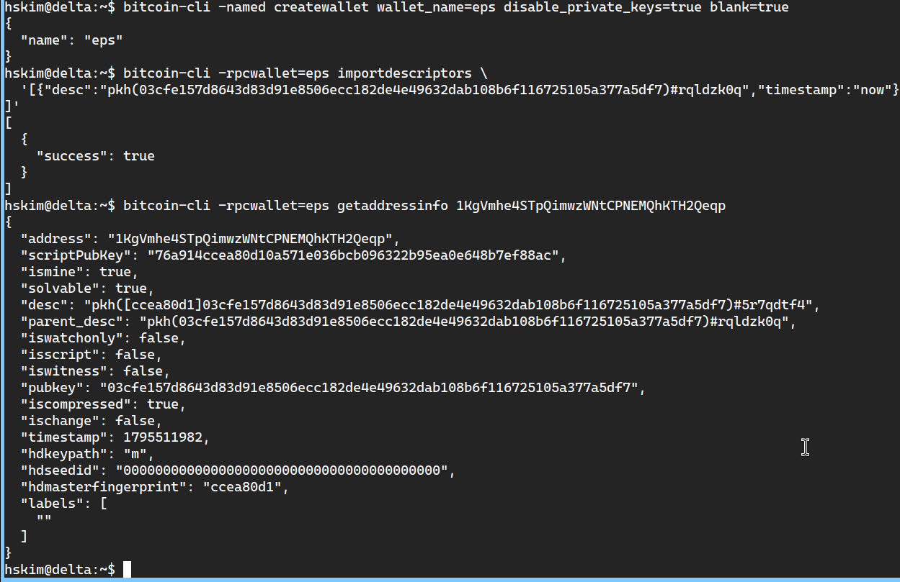

5. 업비트 -> 바이낸스 -> 내 DOGE 주소로 출금
   (업비트 BTC 출금 수수료 0.0002 BTC ≈ 2만원이라 DOGE로 우회)


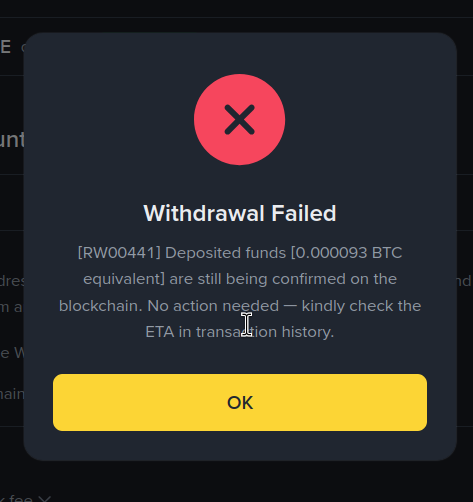
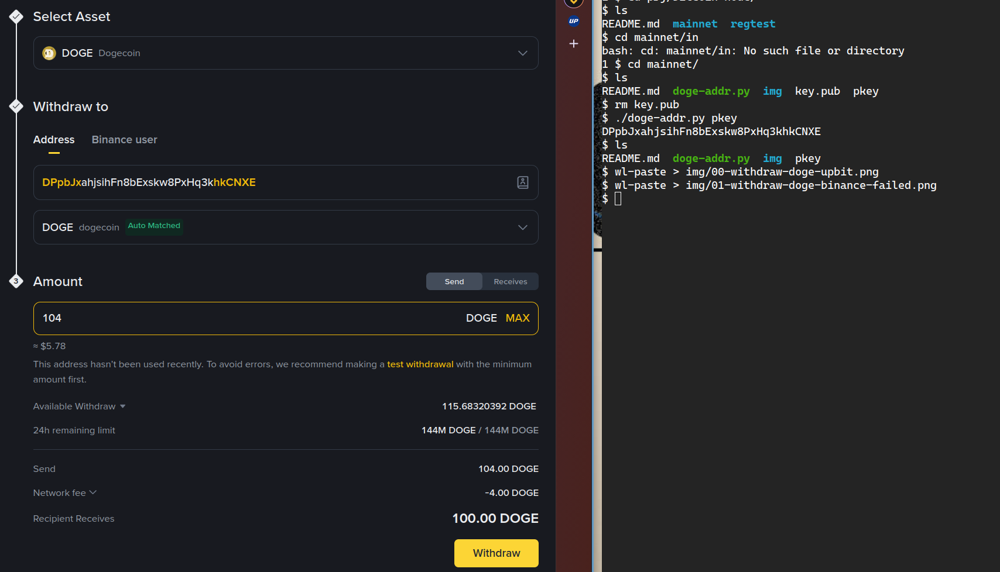
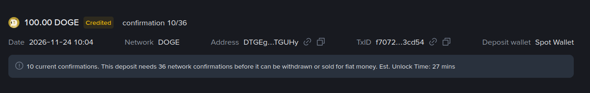
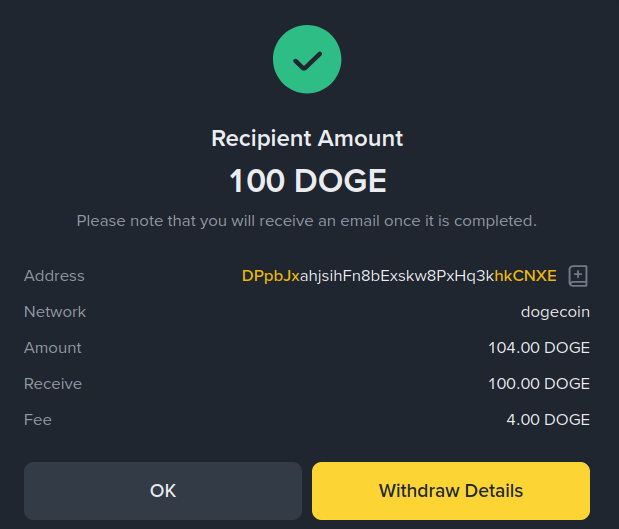
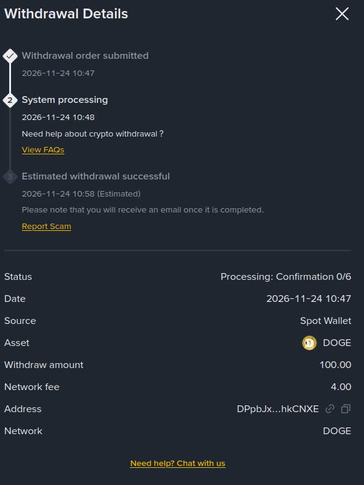
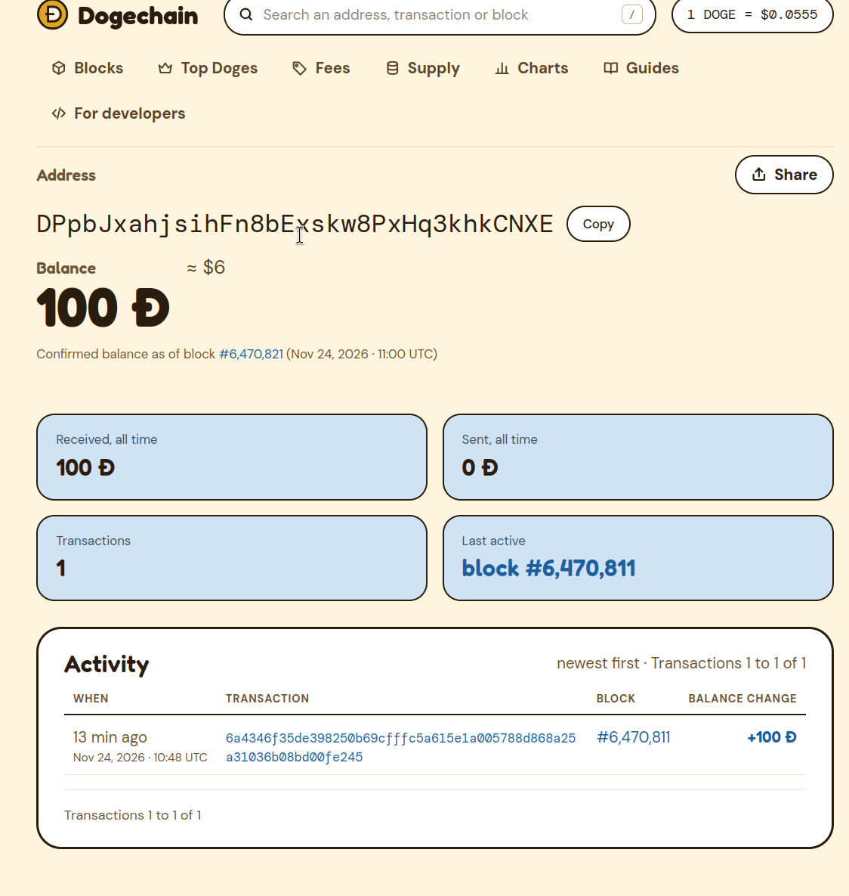

6. 받은 UTXO (txid:vout) 확인
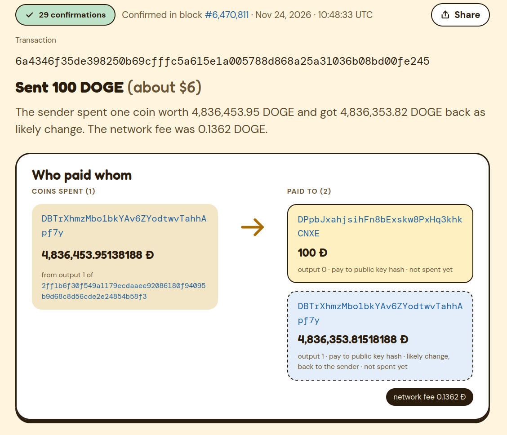

7. ChangeNOW에서 DOGE -> BTC 스왑 생성 (수신: `1KgVm...`)

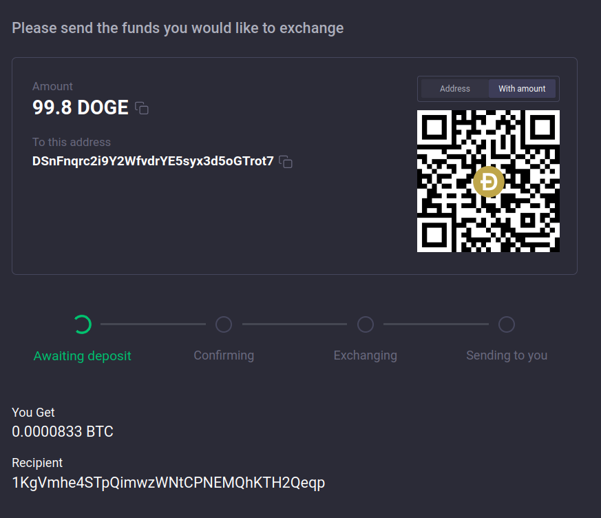

8. DOGE 트랜잭션 직접 서명 ([doge-tx.py](./doge-tx.py), 시스템 libsecp256k1 ctypes)
```
./doge-tx.py key 6a4346...e245:0:100 DSnFnqrc2i9Y2WfvdrYE5syx3d5oGTrot7 max 0.2 > swap.hex
```
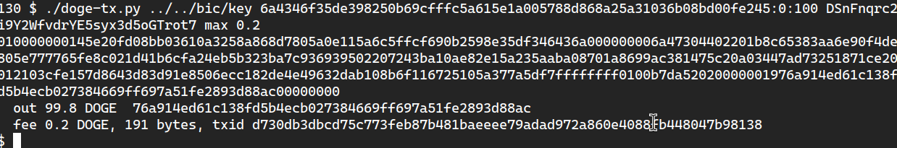

9. 브로드캐스트
```
curl -s -X POST https://api.blockchair.com/dogecoin/push/transaction \
     --data-urlencode "data=$(cat swap.hex)"
```
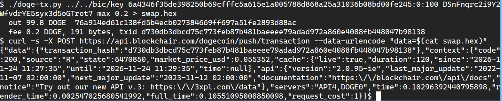
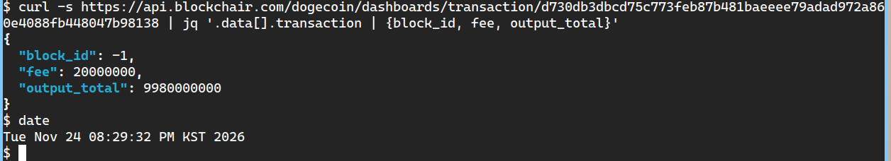
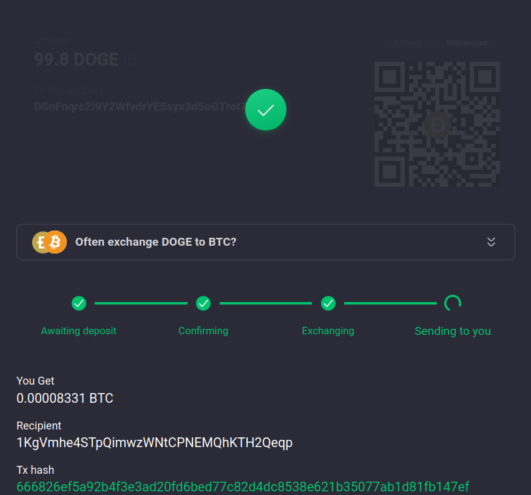
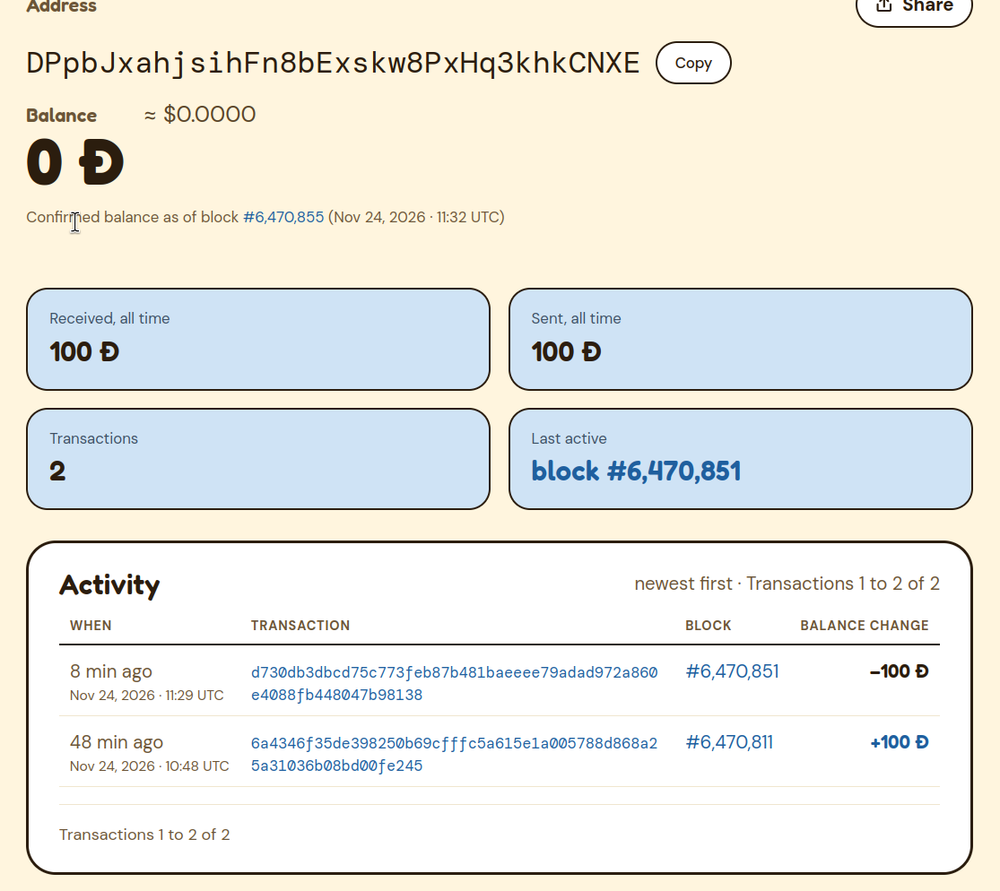

10. bitcoind에서 수신 확인
```
bitcoin-cli -rpcwallet=eps gettransaction 666826ef5a92b4f3e3ad20fd6bed77c82d4dc8538e621b35077ab1d81fb147ef true true | jq '{amount, confirmations, details, vin: .decoded.vin, vout: .decoded.vout}'
```
0 confirm (mempool, P2P로 전파받음) -> 블록 포함되면 1 confirm

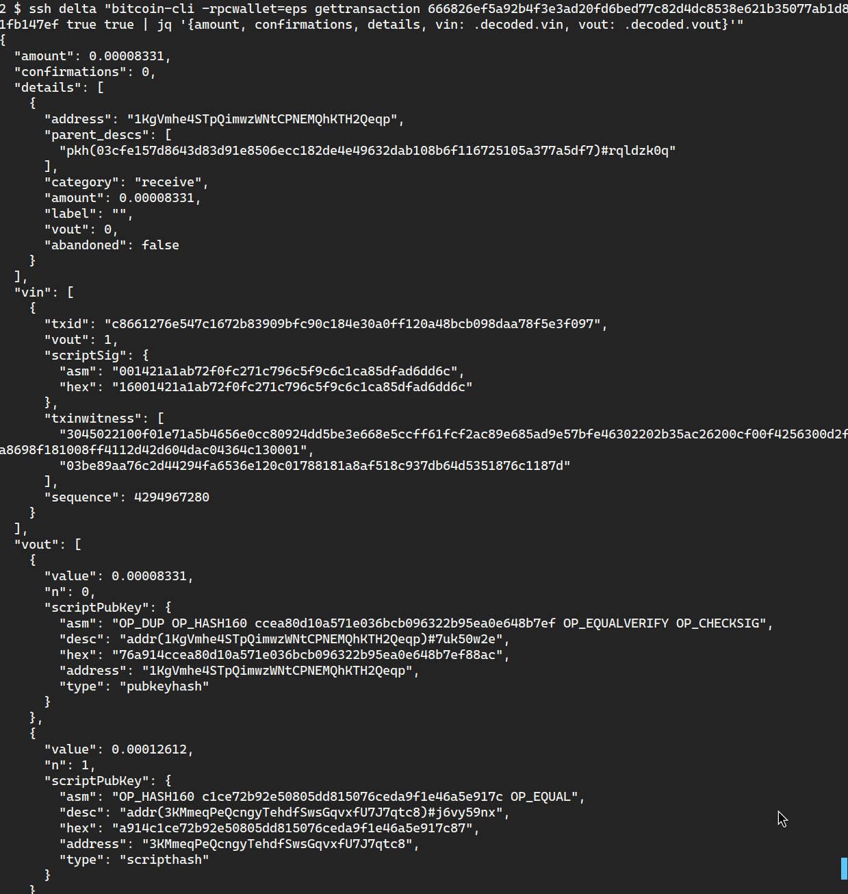
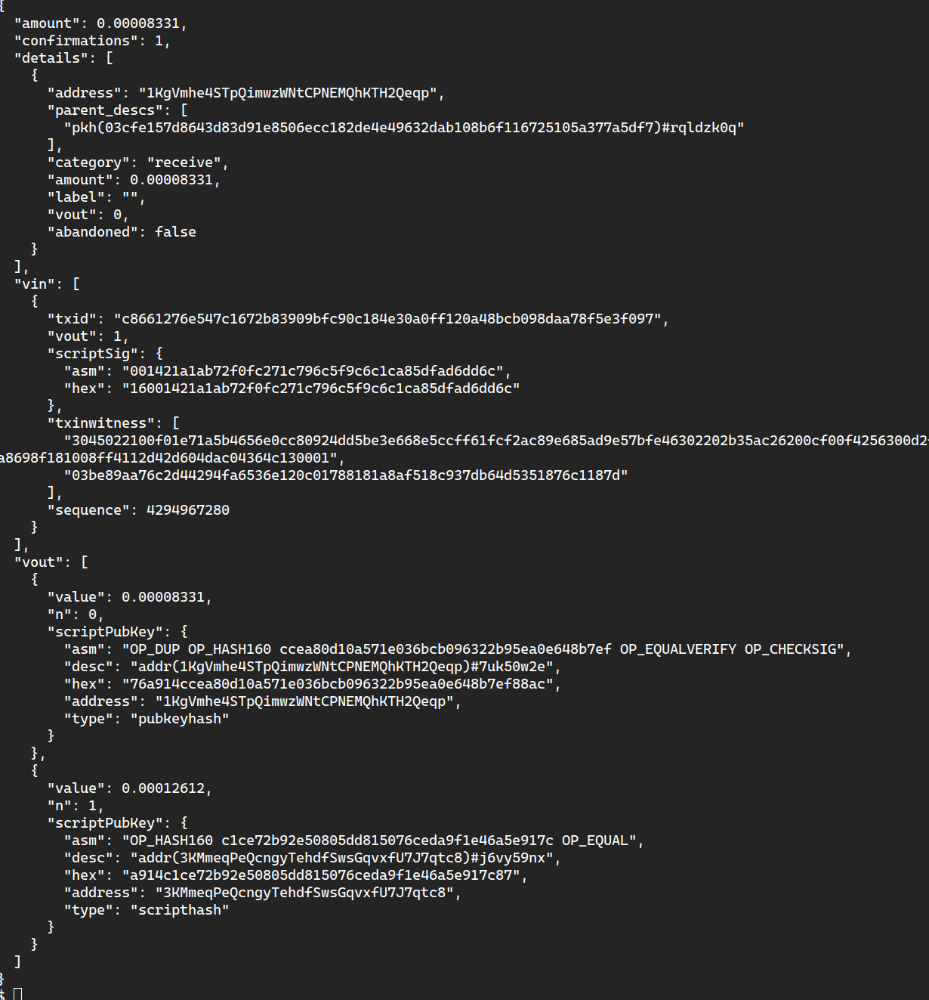

11. 키 잊어버릴지도 모르니깐 pass(1)에다가 저장!
```
pass insert -m secp/a < key
pass show secp/a | ./bic pkey | xxd # 잘 저장되었는지 확인
shred -u key
```
